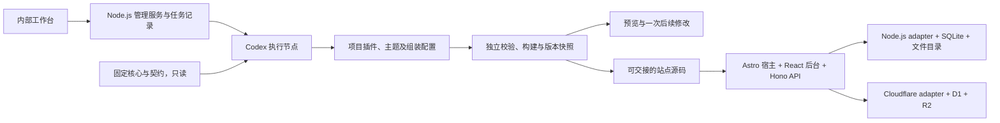

# 可行性 demo：最小技术方案

状态：demo 范围、Astro 技术方向及核心/插件边界已确认；本文为 demo 实现基线，尚未实施。更新：2026-11-08。范围以 [需求第 8 节](requirements.md#8-编码前的澄清进度与就绪条件) 为准，决策见 [ADR-0013](adr/0013-astro-site-host-and-plugin-boundaries.md)，正式实现任务见 [demo-tasks.md](demo-tasks.md)。

## 1. 技术方向与依据

全栈使用 TypeScript。内部管理端采用 React/Vite＋常驻 Node.js/Hono 服务；交付站点由薄 Astro 宿主承载公开页面和主题，React 承载独立后台，Hono 承载业务 API。同一份业务源码分别通过 Node.js 与 Cloudflare adapter 构建，生成执行器只存在于管理端。首期自主实现最小插件宿主，不引入完整 CMS、电商引擎或通用多框架渲染系统。

| 部分 | 方案 | 选择理由 |
| --- | --- | --- |
| 内部工作台 | React/Vite、Tailwind CSS；图标统一 Lucide | 管理生成任务、变更、构建和预览，不随站点交付 |
| 交付站点页面与主题 | Astro 页面/布局，交互部分使用 React | 使用现成页面与服务端渲染约定，主题入口统一，不自建两套渲染系统 |
| 站点后台 | React 页面及插件组件，复用 Tailwind CSS 与 Lucide | 保持后台交互与公开主题职责分离，后台随源码独立交付 |
| 管理服务、站点 API | Hono；站点 API 接入 Astro 请求链，两个目标使用对应 Astro adapter | 保持相同业务与授权逻辑，薄宿主连接页面、API 和平台资源上下文 |
| 编码 agent | 服务端 TypeScript Codex SDK，执行节点使用其配套 CLI | 支持线程、后续修改、流式事件和取消，不自建编码循环；不建设多供应商编排 |
| 数据 | Node.js 使用 `node:sqlite`，Cloudflare 使用 D1 | 两端由适配器承接同一组参数化 SQL 和原子操作；demo 不引入外置数据库服务 |
| 文件 | Node.js 文件目录，Cloudflare R2；构建静态资源另行交付 | 业务只持有逻辑文件 ID，恢复复制实际文件，不依赖源平台 URL |
| 后台认证 | 先实现 Google OIDC，一个真实渠道；使用 `jose` 验证签名和声明 | 落实已接受的最小真实认证范围，暂不接邮件服务或微信准入流程；缺配置时渠道不开放 |
| 授权 | 必需 RBAC 插件，demo 先有 `owner`、只读普通角色及成员角色关联 | 验证纯角色与服务端授权；自定义角色编辑、所有者转移等完整管理界面后置 |
| 验证 | Vitest、Playwright、Wrangler 本地运行及真实测试环境记录 | 将逻辑、浏览器和运行目标验证分开，不将模拟测试当作真实云端验收 |

以上是落实已确认架构的实现选择。站点宿主采用官方 [`astro/hono`](https://docs.astro.build/en/reference/modules/astro-hono/) 集成及 [Node.js](https://docs.astro.build/en/guides/integrations-guide/node/)、[Cloudflare](https://docs.astro.build/en/guides/integrations-guide/cloudflare/) adapter；[Codex SDK](https://learn.chatgpt.com/docs/codex-sdk) 提供服务端线程接口。SDK [`0.167.0` 发布包](https://registry.npmjs.org/@openai/codex-sdk/0.167.0)的类型声明已核对 `runStreamed`、`resumeThread`、工作目录与取消信号；未发起真实生成。

本机 Node.js `24.19.0` 的内存验证已通过参数绑定、条件更新、唯一约束和事务回滚。[对应 Node.js SQLite 文档](https://nodejs.org/download/release/v24.19.0/docs/api/sqlite.html) 将此模块标为 release candidate；本期固定 Node.js 版本，不将其描述为稳定数据库 API。Cloudflare [D1 文档](https://developers.cloudflare.com/d1/worker-api/d1-database/) 提供 prepared statements 和原子 batch；这不等于支持任意带应用回调的交互式事务。两端适配须实现 demo 实际需要的命令与一致性测试。

### 依赖基线

2026-11-08 已只读核对 npm 发布元数据，首次安装以这些版本为起点并提交锁文件，不使用浮动 `latest`；依赖声明不等于已验证整套构建：

| 类别 | 候选固定版本 |
| --- | --- |
| 运行环境 | Node.js `24.19.0`；npm workspaces，使用与运行环境匹配的 npm |
| 服务与认证 | `hono@4.13.17`、`@hono/node-server@2.1.6`、`jose@6.2.15` |
| 界面与构建 | `react@19.3.1`、`react-dom@19.3.1`、`vite@8.3.6`、`@vitejs/plugin-react@6.2.1`、`typescript@7.0.2` |
| 站点宿主与适配 | `astro@7.4.7`、`@astrojs/react@7.1.4`、`@astrojs/node@11.1.11`、`@astrojs/cloudflare@14.4.6` |
| 样式与图标 | `tailwindcss@4.3.5`、`@tailwindcss/vite@4.3.5`、`lucide-react@1.70.0` |
| 执行与验证 | `@openai/codex-sdk@0.167.0`、`wrangler@4.158.0`、`vitest@5.1.0`、`@playwright/test@1.65.0` |

直接依赖的发布元数据声明为 MIT、ISC、Apache-2.0 或 MIT/Apache-2.0 双许可；首次安装仍需检查锁文件里的传递依赖、peer 依赖及许可证。元数据核对不等于整套版本已构建兼容。SDK 配套 CLI 为 `0.167.0`，不默认替换本机已有的 `0.162.1`；不修改用户全局工具、配置或模型选择。

## 2. 最小组成与源码边界

`core` 提供业务契约、薄 Astro 宿主、运行时授权与启停入口、React 后台宿主、平台资源适配、组装工具及内部管理端；运行时与管理端分开打包。Astro 相关页面注册和请求上下文留在宿主，业务服务不依赖 `Astro.locals` 或平台 binding。`plugins` 提供基础企业内容插件、RBAC 插件及 Astro 企业主题。公告插件由 agent 在受管理的项目工作目录新生成，业务源码归插件侧，不修改或自动回写共享核心与插件模板。

每个项目清单锁定核心、插件、主题及契约版本。初期通过本地构建的固定依赖包组装，不以发布 npm 制品为前提；交付包带可获取的固定依赖及其源码，不只留下内部仓库引用。源码包包含运行时、选定插件、主题、锁文件、平台入口和配置样例，不包含管理端、agent、凭据、任务日志或测试数据。

执行节点使用独立工作目录，固定核心和预装依赖只读挂载，插件、主题与组装配置为可写范围；本机 Docker 服务已可读取版本，容器镜像与 SDK 执行尚未验证。工作目录和运行产物留在项目内的忽略目录，不复用本会话的未提交改动；执行节点不挂载 Docker socket 或云部署凭据。模型调用凭据单独注入，禁止进入源码和日志。

每次构建独立检查文件变更范围、依赖清单及固定核心校验值。只读边界或变更检查失败时停止，不把提示词当作核心不可修改的唯一保证。构建由管理服务发起，agent 的完成消息不代替构建结果。SDK 仅负责一次任务及至多两次针对失败的修复，超限保留日志交给操作人，不无限重试。

## 3. 最小插件契约

契约先定义为 `0.1`，允许未来产品阶段显式升级，不承诺本次 demo 接口永久兼容。

| 契约 | 必须表达的内容与边界 |
| --- | --- |
| 插件清单 | 唯一 ID、固定版本、核心契约版本、类型、必需依赖和配置要求；构建拒绝缺失、循环及不兼容依赖 |
| 静态注册 | 插件代码在构建时显式导入，宿主根据声明向 Astro 注册页面、向 Hono 注册 API、向 React 后台注册入口及组件；运行时不下载或安装新插件代码 |
| 主题 | 以 Astro 页面和布局作为入口，可组合 React 交互组件；声明兼容版本，通过契约读取数据，不直接访问平台存储或改核心 |
| API 与权限 | 每个接口声明公开或所需后台权限；未声明不放行。后台写入必须经核心身份及授权入口，不能只控制导航可见性 |
| 存储 | 核心提供按插件命名空间的记录和文件访问；demo 内容记录使用版本化 JSON，暂不开放任意插件 DDL 或跨插件改表 |
| 后台扩展 | 插件提供菜单、页面或编辑组件，复用宿主会话与 API；公告插件自带列表、编辑和发布操作 |
| 生命周期 | 构建补齐依赖，启用时检查并联动启用依赖；停用保护、页面/API/后台状态保持一致，数据保留 |
| 导出恢复 | 保存该版本全部持久记录、引用与实际文件；未知插件或模式版本不能静默跳过 |

公告使用基础内容插件提供的记录与文件能力，声明必需依赖，用于实际验证自动安装、联动启用和停用保护；不为演示依赖而先实现用户管理或 CRM。公告的标题、正文、发布状态及可选图片由公告插件维护；访客只读取已发布内容，正文按文本呈现，不接受未经处理的 HTML。插件被停用后，宿主拒绝其业务 API 并移除前台和后台入口，已有数据继续保留。

页面路由在构建时注册，运行时开关不会卸载已编译路由。宿主在分发请求前检查插件与依赖的有效状态，后台菜单使用相同状态；维护用的授权启用/停用入口继续可达，不能因插件被停用而无法再次启用。公告及后台可编辑、可运行时停用的公开内容使用按需渲染，不预渲染成绕过状态检查的 HTML；demo 不缓存动态内容。静态主题资源可缓存，不能把隐藏导航视为页面已停用。

## 4. 身份、数据与原子操作

管理端只供单个内部操作人在受控环境使用，服务默认仅监听本机；不在本期建设内部组织权限系统或对公网开放执行器。站点后台仍有自己的真实认证，不能共用工作台访问资格。

后台先接 Google OIDC 的授权码流程，校验一次性 `state`、`nonce`、签名、issuer、audience 和有效期；使用提供方稳定主体 ID，不按邮箱自动归并身份。依据为 [Google OIDC 官方文档](https://developers.google.com/identity/openid-connect/openid-connect)；签名校验采用支持 Node.js 与 Workers 的 [jose](https://github.com/panva/jose)。需要配置 OAuth 应用和允许的回调地址，缺少配置不提供假登录替代。

首个管理员仍通过一次性初始化凭据加已验证身份建立，原子写入初始化完成事实及 `owner`，不能重复初始化。只读成员通过部署侧邀请命令创建邀请，验证身份后加入并关联普通角色；本期不做完整邀请管理界面。会话使用服务端记录与受保护 cookie，写入检查来源和 CSRF，角色信息不由浏览器声明。`owner` 与只读角色以相同角色授权入口判定，权限或插件异常时拒绝受保护操作。

| 数据归属 | Demo 保留的最小事实 |
| --- | --- |
| 管理端 | 项目需求、组装清单、任务及事件序号、agent 线程 ID、源码版本、构建与预览记录 |
| 站点核心与基础身份 | 站点 ID、初始化状态、后台成员及验证身份、会话和邀请的运行状态 |
| RBAC 插件 | 角色、角色权限与成员角色；可用权限来自已构建插件声明 |
| 业务与文件 | 插件启用/配置记录、企业内容、公告记录及修订、文件元数据和实际文件 |

站点使用一个数据库保持 demo 的原子边界，管理端任务库与站点业务库分别持有事实。平台适配不向插件暴露 D1 对象或 Node.js 文件路径；参数化命令支持读取、条件写入与固定语句的原子批次，不承诺任意交互式事务。

角色、成员状态及插件状态以权威库为准，不用旧角色列表作为授权事实。受保护写入在同一数据库命令内复核授权、插件启用及记录修订；D1 `batch` 中零行更新不是自动回滚，适配必须显式处理冲突，不能把条件未命中当作成功。Node.js 使用事务实现同一语义，D1 demo 不启用读副本。该一致性边界需以真实适配测试验证。

公告与插件设置采用修订号防止旧编辑覆盖；冲突返回可识别结果并要求刷新。普通请求区分输入无效、未登录、无权限、不存在、版本冲突和服务不可用。数据库异常向上传递并记录脱敏诊断，不返回成功占位响应。

## 5. 工作台流程与版本

任务按项目串行执行；状态为排队、生成中、校验中、构建中、预览就绪，以及失败、取消或中断。任务与有序事件持久化，界面重连按序号读取，SDK 流式事件转换为产品可读的进度；浏览器关闭不会把任务记录丢失。服务重启时将未完成执行标为中断，操作人明确继续，不擅自重放原任务。

后续修改绑定项目与明确的输入源码版本，继续对应 agent 线程或从固定源码重新建立上下文，不能使用“最近一个线程”推断项目。失败和取消不覆盖上一份成功预览；每次成功预览都有固定源码、清单、构建产物和校验结果。后续修改生成新版本，不替换已选择交付的快照。

预览独立于工作台来源，使用测试配置和数据，不能读取工作台会话或管理凭据。首次可运行闭环可以先由样例插件验证运行时，再接真实生成；最终 DM1 必须记录真实 agent 新生成公告插件的结果。源码导出由操作人选择版本，正式部署另行明确发起，不内置自动生产发布。

## 6. 数据导出与恢复

使用带模式与插件版本的逻辑数据包，包含记录、关系、文件清单和实际文件及校验值，不使用原始数据库文件冒充通用恢复格式。管理任务历史不属于站点数据包，密钥单独配置，会话和一次性凭据不作为可复活权限导入。

demo 使用小规模测试数据，在受控维护模式下暂停所有写入、完成在途写入后导出。数据库与文件没有跨资源事务，导出必须以冻结后的实际引用为准校验；缺文件或版本不匹配即失败。只恢复到全新目标资源，目标验证完成前保持不可写；保留成员/角色关系和已完成初始化事实，生成新会话世代，不重开初始化入口。

以 SQLite→D1、D1→SQLite 证明最小跨平台闭环，并用断开源数据库后的读取和后台操作验证实际接管。同平台恢复可复用相同流程。配置恢复所需的目标资源与原 Google 应用/回调兼容性单独校验；演示不涉及订单、支付任务或未来业务模式升级，不承诺在线迁移和生产备份服务等级。

## 7. 最小界面设计

DESIGN SPECIFICATION

- 用途：内部操作人从需求到预览，能判断生成是否成功并继续修改；站点经营者独立维护企业内容和公告。
- 方向：工作台与后台采用 Industrial/utilitarian；企业主题采用 Editorial/magazine。
- 配色：纸白 `#F4F2EB`、墨黑 `#202925`、深绿 `#245B45`、琥珀 `#D99B35`、错误红 `#B54636`，不使用渐变。
- 字体：标题与正文使用自托管 Noto Sans SC，版本和日志使用 IBM Plex Mono；保留字体许可，不依赖访问外部字体 CDN。
- 布局：窄项目导航、主需求/结果区和侧边执行轨迹形成不等宽布局；主题使用大标题与偏置公告列表，保留清晰阅读顺序。窄屏转为上下排列，优先操作可达性，不为视觉打断任务流程。

首期按四类页面组织：工作台项目页、生成与预览页、公开企业站/公告页、后台内容页；登录及初始化是必要入口状态。工作台展示需求、插件清单、执行进度、变更摘要和预览/导出操作；工具日志放入可展开区域。后台复用列表和编辑区，明确草稿、发布、空数据、无权限、版本冲突和失败状态。主题不把内部任务或执行器信息暴露给访客。

进入界面实现前沿用此规格，并读取 Web 实现约定；不在本轮制作高保真原型或编写 UI 代码。

## 8. 实现与验证顺序

正式可执行任务与完成证据维护在 [demo-tasks.md](demo-tasks.md)，以下保留整体交接顺序；任务尚未开始，不能将设计确认当作验证通过。

| 顺序 | 应看到的结果 | 验收关联 |
| --- | --- | --- |
| 1 | 固定核心加载基础插件与主题，Node.js 上完成公开页面和后台实际数据读写及只读拒绝 | DM3、DM4 |
| 2 | 同一业务代码在 Workers 本地运行，SQLite/D1 原子语义及文件适配一致；在全新目标完成小数据恢复 | DM5、DM6 |
| 3 | 工作台触发真实 Codex 生成公告插件，校验写入范围并构建出预览 | DM1、DM3 |
| 4 | 提出一次修改，形成新版本；断开管理端运行固定源码，并执行双目标、权限、启停和恢复验收 | DM2、DM4–DM6 |

本轮已完成的是官方文档、发布元数据与 SDK 类型核对，以及 Node.js 内存 SQLite 验证。尚未安装依赖、构建应用、调用模型、验证真实 Google 登录或部署 Cloudflare，版本组合和端到端行为都不能标为已通过。

实施所需外部条件为：可用的 Codex 认证及调用额度、Google 测试应用和回调配置、Cloudflare 测试账户及经授权配置的 Workers/D1/R2。缺少这些条件不阻塞无外部调用的核心开发，但相应真实验收保持未验证；不请求用户把凭据粘贴到对话或提交到仓库。

## 9. Astro 选型依据与验证边界

评估日期：2026-11-08；依据官方文档与只读发布元数据，不包含构建、性能或 agent 生成成功率对照实验。用户已同意交付站点由薄 Astro 宿主承载页面、主题使用 Astro、后台使用 React、业务 API 保留 Hono；内部工作台保留 React/Vite＋Hono。下表保留选型理由，不再将两套框架列为待决方案。

Astro 可以与 React、Hono 组合。官方 [React integration](https://docs.astro.build/en/guides/integrations-guide/react/) 支持 React 组件的渲染和客户端交互；Astro 7 的 [`astro/hono`](https://docs.astro.build/en/reference/modules/astro-hono/) 提供 Hono 兼容的路由处理器，[v7 升级说明](https://docs.astro.build/en/guides/upgrade-to/v7/#experimental-flags) 已将 advanced routing 列为默认能力。由此可保留原 Hono 业务契约，不必为采用 Astro 再起一个站点 API 服务。

| 评估项 | Astro 作为交付站点框架 | 原 React/Vite＋Hono 方案 |
| --- | --- | --- |
| 企业展示与公告页面 | 自带页面、布局、预渲染和按需渲染约定，适合主题生成 | 默认 SPA 能完成界面，但页面 SSR、预渲染和相应工程约定需另行接入 |
| 首屏与内容可见性 | 可直接输出内容 HTML，按需加载交互组件 | 普通 SPA 依赖客户端获取并渲染内容；也可实现 SSR，但该能力未包含在原最小方案中 |
| 工作台和后台交互 | 可承载 React 后台，但无须将内部工作台迁入 Astro | 单一 React 组件和客户端状态体系，适合任务进度、表格和编辑流程 |
| 插件页面与主题 | 可用 integration 注册页面和处理器，主题有明确布局边界 | Hono API 路由与 React 页面注册更直接；页面路由、渲染及资源交付仍由宿主组装 |
| 双运行目标 | 官方 Node.js 与 Cloudflare adapter，按目标分别构建和验证 | Hono 的两个运行入口；Vite 静态产物和后端的路由交接自行组织 |
| 本期工作量 | 增加 Astro 及适配器依赖，需处理 `.astro` 与 TSX 边界；减少公开站点页面框架的自建工作 | 工具种类更少，管理界面复用直接；若补齐面向内容的渲染能力，自建面会增加 |
| 业务核心与数据恢复 | 仍需实现依赖、RBAC、启停、数据库及文件恢复 | 同样需要实现，不应归为某个页面框架的现成功能 |

上述适配与渲染能力依据官方 [Node.js adapter](https://docs.astro.build/en/guides/integrations-guide/node/)、[Cloudflare adapter](https://docs.astro.build/en/guides/integrations-guide/cloudflare/) 及 [按需渲染](https://docs.astro.build/en/guides/on-demand-rendering/) 文档。工作量和适用性判断是针对本项目的推论，不声称已经测得更快生成、更低延迟或更小产物。

### 职责分配

| 部分 | 已确定边界 |
| --- | --- |
| 内部工作台 | React/Vite UI＋Node.js/Hono 管理服务＋Codex SDK，维持原边界 |
| 交付站点的公开页面与主题 | Astro 页面/布局，交互部分按需使用 React；主题可以组合 Astro 与 React 组件 |
| 交付站点业务后台 | React 页面与插件组件，由站点宿主提供独立 `/admin` 入口，不依赖内部工作台 |
| 站点业务 API | Hono 路由与统一授权检查，接入 Astro 的请求链；薄适配负责平台资源上下文，避免重复定义两套路由和权限 |
| 数据、文件与恢复 | 继续使用原 SQLite/D1、目录/R2 的适配设计，不因更换页面框架改变业务数据归属 |

### 必须保留的验证边界

- 插件构建安装与页面注册可通过 Astro [integration 的 `injectRoute`](https://docs.astro.build/en/reference/integrations-reference/#injectroute-option) 完成；依赖解析、版本、RBAC 与运行时启停仍属于 Argos 契约，不能把 Astro integration 直接当作完整业务插件系统。
- 公告及可在后台修改、可运行时停用的公开内容使用按需渲染，请求时检查启用与发布状态；不将其默认预渲染成长期可访问的 HTML。否则后台发布与停用可能必须重新构建才能生效。稳定静态资产仍可缓存，demo 先不引入动态内容缓存。
- 同一份源码分别通过两种 adapter 构建，不承诺相同构建产物跨平台直接运行。业务插件通过核心契约读取数据，平台特定的 bindings 和 `node:sqlite` 留在适配层。Cloudflare 的本地运行路径使用 workerd，也仍须验证真实云端配置。
- 权威会话与角色判定继续走既定数据库边界，不因 Astro 提供 Sessions API 就自动替换成平台默认存储；这会影响双平台恢复和撤权语义。
- 不同时建设两套主题渲染系统。公开站点的主题入口统一采用 Astro，后台 UI 统一采用 React；后续复杂交互仍可通过 React 实现。

具体版本统一维护在第 1 节依赖基线。已核对 Astro、Node/Cloudflare adapter 的 peer 声明范围，仍需实际安装、构建和请求链验证。

若未来产品转为以登录后复杂交互应用为主，可以重新评估统一 React 方案；本期按已确定的分工实施。首批集成验证必须证明插件页面可注册、React 后台发布后即能读取、停用后页面和业务 API 均拒绝，在 Node.js 与 Workers 两端通过同组用例。
