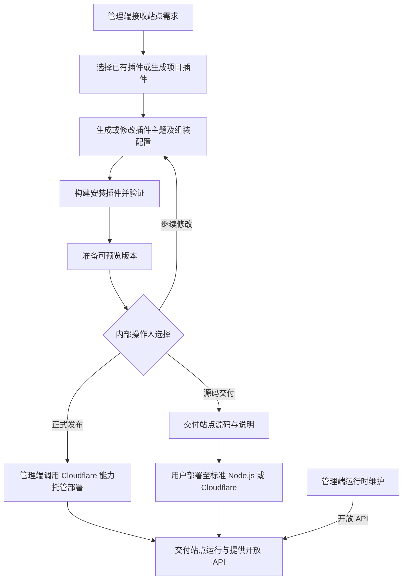
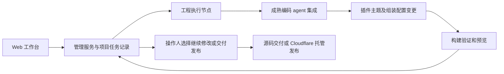

# Argos 管理端需求

状态：需求澄清中。更新：2026-11-08。总体要求见 [需求总览](requirements.md)，另一套需求见 [站点交付物](site-deliverable.md)。

当前第一期以可行性 demo 为目标，电商延期，见 [ADR-0012](adr/0012-feasibility-demo-first.md)。已确认先贯通一个内部操作人、一个项目、串行生成任务及构建预览；真实 agent 生成新插件与后台扩展，继续修改后交出可独立运行的源码。下列多项目、生产托管及运营能力保留为完整产品方向，不逐项阻塞 demo；最小样例和验收已按 [需求第 8 节](requirements.md#8-编码前的澄清进度与就绪条件) 整体确认；实现边界见已收敛的 [最小技术方案](demo-design.md)，执行入口见 [首批任务](demo-tasks.md)。

## 1. 定位与已确认职责

管理端采用 Web 工作台，由 agent 执行站点及插件生成。允许复用已有插件，也允许按需求生成新的项目插件；所有站点和插件代码生成均在管理端完成。可以采用成熟的 agent SDK，Codex 为用户提出的候选，尚未确定具体实现。

操作人在工作台只进行插件组装、插件创建或编辑、主题创建或编辑。主题是一类插件，站点页面和视觉定制落在主题代码中。生成和修复任务的写入范围是插件、主题及组装配置；管理端自身、站点核心运行时、后台宿主和公共契约代码不属于站点生成任务的修改范围。

管理端永久仅供内部团队使用，永远不向客户交付，也不提供客户自助使用入口。这是长期产品边界，后续不规划将其转为面向客户的站点生成 SaaS 或可交付管理软件。客户交付范围是生成的站点源码、独立业务后台及约定的托管服务。

内部团队可以根据服务约定为客户持续生成、部署和维护站点；内部使用管理端维护客户项目，不意味着向客户开放管理端。内部多项目和团队协作的具体流程仍需设计。

客户自行修改交付源码后，不要求支持重新接入管理端继续生成和升级。管理端不必实现客户修改版本的导入、差异回流和自动合并流程；对内部持续维护的工程，仍需明确项目定制保留和版本升级方式。通过站点业务后台修改内容、商品或配置不视为修改源码，也不因此退出正常业务维护。

管理端的托管方案调用 Cloudflare 平台能力部署和维护站点，并通过站点交付程序提供的开放 API 完成相应运行时维护。管理端自身部署明确不限定 Cloudflare；根据编码 agent、工程文件、命令执行、构建和任务管理需要选型，技术栈与部署平台尚未确定。交付站点的双运行目标不限制管理端的部署方式。

已确认托管资源位于客户自有 Cloudflare 账户，由客户授权团队代管；首版支持完整数据导出并恢复到 Cloudflare 或 Node.js，见 [ADR-0010](adr/0010-customer-owned-hosting-and-portable-data.md)。账户接入、维护凭据、资源映射、撤销及交接按 [托管与数据交付提案](site-deliverable.md#8-客户账户托管与完整数据交付) 细化，不将代管授权等同于本站后台 `owner`。

## 2. 候选功能范围

下列功能用于细化已确认职责，具体流程与优先级待确认。

| 能力 | 建议职责 | 待明确 |
| --- | --- | --- |
| 需求与项目 | 保存站点目标、页面、业务模块、设计要求和运行目标 | 输入形式、需求确认和项目协作方式 |
| Agent 任务 | 从工作台发起生成和修改，连续生成、修复、构建验证与预览，再由操作人选择修改、交付或发布 | 继续对话、取消、失败恢复、并发及费用记录的具体范围 |
| 插件管理 | 注册、检索、选择和维护插件及版本，记录依赖和适配范围 | 插件来源、注册方式、共享与项目专属插件边界 |
| 站点生成 | 选择固定核心版本，组装插件和主题，生成工程配置与交付源码 | 组装清单、依赖锁定、工程打包及核心依赖交付方式 |
| 项目插件生成 | 补齐已有插件无法满足的功能，生成业务实现及对应后台管理扩展 | 验证流程、注册与复用方式；安全评估由注册操作人负责 |
| 主题创建与编辑 | 生成或修改主题的页面、布局、样式和插件呈现，按核心契约注册 | 主题配置、内容槽位、兼容性及激活规则 |
| 后续修改 | 基于内部维护的插件、主题和组装配置生成新交付版本 | 核心版本通过独立发布维护；不包含客户自行改后源码的重新接入 |
| 构建与验证 | 安装选定插件并自动补齐必需依赖、固定版本、检查依赖、构建并验证选定运行目标 | 构建环境、测试与预览方式、失败修复流程 |
| 源码交付 | 输出可维护源码及运行、配置与维护说明 | 仓库、压缩包、版本归属和交接方式 |
| 托管发布 | 经授权在客户自有 Cloudflare 账户发布，关联域名、环境配置与资源 | 账户归属已确认；授权接入、资源管理、费用和发布恢复待细化 |
| 运行时管理 | 调用站点开放 API 查询状态、管理配置、控制已安装插件启停 | 具体 API、凭据生命周期、批量管理与失败处理 |
| 日常业务管理入口 | 可额外调用站点 API 提供跨站点业务操作 | 站点已确认独立交付业务后台；管理端是否另提供集中业务界面待确认 |

## 3. 管理数据与站点业务数据的边界（建议）

管理端保存需求、工程及源码关联、插件元数据、生成和构建任务、交付版本、部署关联与维护记录。站点的账号、内容、订单、支付、库存和 CRM 等业务事实由交付站点及其业务模块维护。

管理端可以通过已授权 API 获取或维护业务数据，但不能要求站点读取管理端内部数据库才能正常提供业务。管理端与站点的用户身份、配置和版本记录需要分别定义，避免将跨站点管理账号直接当作交付站点的买家账号。

管理端用户是内部成员。客户、站点经营者和最终访客按交付站点的身份与业务规则使用站点，不因此获得管理端账号。站点所需的标准用户管理与 CRM 不作为管理端对外服务的用户或客户体系。

具体数据存储与同步方案尚未设计；此处不要求管理端持有全部站点业务数据副本。

## 4. 已确认的生成与交付流程

运行时维护与代码修改走不同路径：配置或启停变更调用站点 API；涉及插件或主题新代码、版本变更的操作回到管理端的构建和发布流程。生成任务使用固定核心版本，不直接修改核心代码；核心版本演进由独立核心维护流程完成。具体哪些配置可实时修改，由站点 API 契约定义。

### 生成、预览与发布的操作边界

已确认 agent 在一次生成任务中连续完成源码生成、必要修复、构建验证和预览准备，工作台展示过程、代码变更和验证结果。内部操作人检查预览后，可继续提出修改，或针对当前版本选择源码交付、正式托管发布。每次新变更产生相应的新版本与预览，交付和发布关联具体版本。

默认生成流程产出可预览版本，正式发布由操作人发起；预览与生产发布分别记录。构建或验证失败时保留失败状态及结果，不能将失败任务当作已就绪的预览版本。具体预览环境、操作入口与 agent 任务控制方式仍待设计。

当前 demo 的最小样例与验收见 [需求第 8 节](requirements.md#8-编码前的澄清进度与就绪条件)，将需求、源码、构建、预览与导出版本关联起来。原两份完整业务参考组装保留在 [站点交付物第 7 节](site-deliverable.md#7-首版可交付功能与验收基线提案)，不作为 demo 全部实施项；正式发布仍由操作人决定。

建议进一步让源码版本、构建结果、预览环境、交付记录和部署记录显式关联。操作人选择已检查版本后，后续任务产生的新代码不能隐式替换该次交付或发布的目标版本；具体版本记录方式仍待设计。

## 5. 候选验收

- 根据一份需求生成包含所选模块的完整站点源码，接手者能按说明在两种运行目标部署。
- 需求缺少现成能力时，由管理端生成项目插件，纳入构建后交付；交付站点运行时不承担生成或安装该插件的任务。
- 生成的业务插件包含对应后台管理注册与必要操作接口，交付站点不依赖管理端界面完成日常业务管理。
- 生成、构建或发布失败能定位任务与原因，修改后产生可追溯交付版本。
- 管理端部署托管站点后，通过站点 API 控制已安装插件启停；新增插件则重新生成或修改工程并构建发布。
- 管理端不可用时，已有交付站点按自己的运行与外部服务配置继续提供业务；具体维护降级与恢复细节待设计。
- 对内部持续维护的项目，后续生成与升级保留项目已有定制，具体版本与验证策略待设计；不将客户自行修改源码后的重新接入作为验收要求。
- 管理端由内部成员操作；客户交付包不包含管理端应用、生成执行器或其部署依赖，客户仍可使用独立站点业务后台。
- agent 连续完成生成和验证，工作台提供可预览版本及变更结果；操作人可以继续修改，也可以选择源码交付或正式发布。
- 继续修改后形成新的版本与相应预览；交付和发布记录能定位所选择版本。预览生成完成本身不触发正式发布。
- 操作人创建或编辑插件、主题并组装站点，构建前后核心源码无改动；核心扩展点不足时，任务报告缺口，不自动修改核心绕过契约。

## 6. Web 工作台与 agent 的分工（建议）

| 部分 | 建议职责 |
| --- | --- |
| Web 工作台 | 需求输入、项目与站点列表、任务进度、源码变更、预览和交付版本等操作界面 |
| 管理服务 | 项目、需求、源码版本、插件、任务、交付与部署记录；连接工作台、执行器与托管平台 |
| Agent 执行与构建节点 | 准备固定版本核心，调用成熟编码 agent 编辑插件、主题及组装配置；构建和验证产物并返回结果 |

这些是同一管理端内部的职责，不要求分别部署成服务。候选方式是将 Web 与管理服务部署在常规服务环境，执行能力使用具备工程文件、命令及构建工具的服务进程或容器；具体运行位置、进程关系和存储方案待设计。

### 成熟 agent 集成

建议以薄适配层连接工作台任务和选定编码 agent，不自建通用编码 agent 循环，也不预先建设庞大的多供应商编排平台。具体选型仍需验证。SDK 会话 ID 与管理端项目、任务和交付版本分别记录，不能让供应商会话记录取代项目的源码与版本事实。

已核实 Codex 提供服务端 SDK 与 app-server 两类相关集成入口，区别和官方依据见 [Codex 集成调研](research/codex-integration.md)。工作台的持续会话和过程交互需求会影响选择；“Web + agent”已确认，不等于已经锁定某个 SDK、协议、模型或认证方式。

### 任务与工程维护建议

- 用项目需求、插件契约、工程规范与现有源码为 agent 提供上下文；生成插件时包含对应业务后台管理功能。
- 核心工程作为固定版本依赖或只读参考，任务变更集仅覆盖插件、主题和组装工程；如何检查写入范围将在实现阶段确定。
- 每次任务关联输入源码版本、输出变更、验证记录和交付版本；明确同项目并发修改的协调方式。
- 区分对话与执行状态、构建验证状态、交付版本和部署状态。agent 宣布完成不自动等于工程构建通过或已经发布。
- 工作台刷新或连接断开后可重新查询任务，任务状态不能仅保存在浏览器连接中。
- 中断、重试和恢复不能隐式重复发布或覆盖其他任务的变更；SDK 会话可继续与任务可恢复是两个需要分别验证的能力。
- 源码、项目需求和交付记录归管理端管理，站点源码交付不附带其生成任务的执行依赖。

上述内容为候选契约，不预先要求特定队列、容器平台或任务数据库。

## 7. 待确认

已确认 Web 工作台加 agent 执行生成、管理端部署不限定 Cloudflare，以及管理端永久仅内部使用、不向客户交付或开放。客户自行改后源码不要求重新接入。生成流程已确定为 agent 连续完成生成、修复、构建验证和预览，再由操作人选择继续修改、交付源码或正式发布。

已确认操作人只组装插件、创建或编辑插件和主题，核心代码独立维护；主题承担页面和视觉定制。当前只收敛 demo 所需的插件契约、固定核心依赖、任务执行、构建预览和源码交接；多人协作、集中业务界面与生产托管为后续产品设计。电商及其支付、物流适配器已延期，不再阻塞当前推进。
