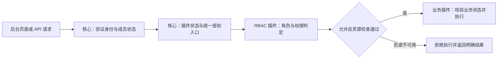

# RBAC 插件设计 v1

状态：v1 设计已补齐，待整体评审；尚未实施。更新：2026-11-08。需求 R53–R60 及 ADR-0009 中的已确认规则继续有效。下文标为“v1 建议”的权限拆分、普通角色管理范围、所有者撤销、接口、存储与一致性规则是本轮完整设计提案，不因写入本文而成为已接受决策。

## 1. 结论与范围

已确认将 `rbac` 作为站点业务后台的必需基础插件，提供角色、角色授权和权限判定；核心保留身份与成员基础及统一服务端授权入口。权限声明承载与必需能力检查的具体契约按后文草案细化。后台依赖授权能力，由 RBAC 插件提供；插件异常或缺失时不能放行后台受保护操作。

本轮先设计交付站点的后台成员权限。内部管理端的团队权限、前台会员等级、买家订单所有权，以及服务调用方的细分授权分别设计，不因安装 RBAC 而共用角色或自动成为管理员。

当前 `core` 与 `plugins` 只有文档和骨架。本文列出的授权接口、后台宿主必需能力和事务协作均需实现，不能视为现有 API；不在本轮选择框架、数据库、认证 SDK 或授权库。

| 范围 | 设计状态 |
| --- | --- |
| 必需 RBAC 插件、核心统一检查、纯角色授权、多角色并集、自定义角色、多所有者及全部后台权限 | 已确认，见 R53–R60 |
| 角色管理与成员角色分配分开；角色管理员可配置本人尚未拥有的普通权限 | v1 建议，见第 5 节；这是权限管理员能力，不能当作普通业务编辑权限分发 |
| 所有者相互撤销、退出与转移；角色删除和模板行为 | v1 建议，见第 5 节 |
| 授权契约、版本、事务、撤权边界、故障恢复及验收 | v1 建议，见第 6–10 节；双运行目标必须满足同一语义 |

首版不提供角色继承、成员直接授权、个人可授予权限清单、显式拒绝策略、动态脚本策略、授权提供者热切换。前三项中的“成员直接授权、个人清单”已被用户排除，其余为缩小首版实现范围的建议。CRM 数据范围、买家资源所有权和服务调用方认证继续由各自契约负责，不扩成通用策略引擎。

## 2. 已确认约束与方案比较

- 每站交付独立业务后台及成员登录与授权，不依赖可选的前台用户管理插件。
- 成员支持按后台配置开放的 Google、微信网站扫码及邮箱一次性登录链接；认证渠道不决定业务权限。
- 首个管理员通过一次性初始化凭据保护的页面创建，后续成员由具备成员管理权限的人邀请并分配权限。
- 插件构建时安装，运行时控制启用；必需依赖自动安装、联动启用，被依赖时拒绝停用。
- RBAC 为后台必需基础插件，随后台自动安装并联动启用；后台依赖期间不得停用，授权缺失或故障时不放行受保护操作，核心保留统一服务端检查入口。
- 角色管理支持预设模板与自定义角色，管理员可以创建角色并选择权限，不限于分配固定角色；具体模板、权限矩阵和授权管理边界待确认。
- 普通角色的创建、修改、删除及权限配置由拥有角色管理权限的用户控制，可由非 `owner` 成员承担；具体保护规则待细化，不包含 `owner` 系统角色管理。
- 只支持按角色授予权限：权限配置在角色上，成员通过角色获得权限；普通角色由拥有角色管理权限的用户控制，该管理权限同样通过角色授予。不增加成员单项权限或个人可授予权限清单。
- 一个后台成员可分配多个角色，操作权限取并集；站点、资源范围及业务状态校验仍适用。
- 保留受保护的站点所有者 `owner` 系统角色，首个管理员自动获得；支持多个 `owner`，现有有效所有者可向本站其他后台成员授予该角色，禁止移除最后一位有效所有者；撤销与转移规则待确认。
- `owner` 自动拥有本站全部已注册后台权限及新增插件权限，无需逐项手动授予；仍受成员状态、插件启用、站点与资源边界及业务状态校验约束。
- 插件为可信代码，安全评估由注册操作人负责；本方案不增加恶意插件沙箱。

| 路径 | 核心与插件边界 | 代价与选择 |
| --- | --- | --- |
| A：RBAC 为后台必需基础插件，已选 | 核心执行统一检查；插件持有角色、授权关系和判定策略；后台要求有效授权提供者 | 保持核心较小；RBAC 不能在后台依赖它时停用，需要明确授权故障的部署侧恢复方式 |
| B：可选 RBAC 增强插件，未选 | 核心先实现一套始终有效的基础授权，插件启用后切换为 RBAC | 必须同时维护基础策略、角色策略和切换迁移；不能在停用插件后自动把成员变为管理员 |

用户已选择 A，见 [ADR-0009](adr/0009-required-rbac-provider.md)。“必需”描述交付和依赖关系，不要求代码内置核心；角色管理另已确认预设模板、自定义角色及多角色权限并集。以下按已确认范围展开候选实现，能力名称、数据结构及具体接口并未一并获准。

## 3. 职责边界与候选依赖契约

| 部分 | 职责 | 数据与实现归属 |
| --- | --- | --- |
| 核心身份与成员基础 | 登录、会话、成员状态、邀请、初始化一次性凭据；提供经验证的主体与站点上下文 | `core`，不要求安装访客用户管理 |
| 核心授权入口 | 承载权限声明；统一拦截后台服务端操作；检查业务插件状态与授权提供者是否就绪；处理拒绝和不可用 | `core`，不实现角色 CRUD、角色表或 RBAC 关系计算 |
| RBAC 插件 | 权限目录视图、角色模板、自定义角色、成员与角色关联、授权判定、策略版本和变更记录 | 候选位置 `plugins/extensions/rbac/`，实际包结构待选型 |
| 业务插件 | 声明自身权限，保护服务操作，校验具体资源和业务状态；提供对应后台注册 | 各业务插件，不直接读取 RBAC 的角色表或判断角色名称 |
| 后台宿主 | 呈现插件注册的管理界面，按授权结果显示菜单与按钮 | UI 使用同一授权语义，服务端仍独立检查 |

后台宿主声明必需能力 `site.authorization`；RBAC 提供该能力，并依赖核心的成员、权限声明和存储契约。业务插件调用核心统一授权入口，不直接依赖具体 RBAC 包。默认组装通过构建清单锁定一个提供者；第一版不做多提供者同时判定或运行时热切换。

成员邀请由核心承载，角色选择与授权由 RBAC 承载：核心通过授权提供者校验和提交角色分配，不直接操作插件存储。反向调用核心成员查询是契约使用，不产生两个包的构建依赖环。

上述能力依赖已确认需要覆盖“后台宿主必需的 RBAC 插件能力”；具体声明契约和机制尚未实现。

## 4. 角色与权限模型

已确认支持预设角色模板与自定义角色，管理员可以创建角色并选择权限。一个后台成员可分配多个角色，各角色的操作权限取并集。例如角色甲授予读取、角色乙授予编辑，兼任两者即可读取和编辑；相同权限去重。移除角色乙后，若其他有效角色均不再授予编辑权限，成员即不再具有该权限；撤权的生效时点和一致性机制按第 7 节细化。站点、具体资源和业务状态校验始终适用，不因权限并集被取消。

已确认成员只通过角色获得权限，不直接给成员附加单项权限，角色管理权限本身也配置在角色上；不增加个人可授予权限清单。建议第一版采用平面 RBAC，不增加角色继承、显式拒绝规则或通用策略脚本；这些模型限制仍为候选。如需引入额外拒绝策略，必须另行明确与已确认并集规则的关系。

| 概念 | 建议表达 |
| --- | --- |
| 成员引用 | 使用核心提供的本站成员 ID 和状态，不复制 OAuth 身份、邮箱验证或会话体系 |
| 角色 | 站点内稳定 ID、名称、描述、系统角色标记与版本 |
| 角色权限 | 角色到已声明权限 ID 的关联，普通角色显式枚举，不因新插件发布自动扩权 |
| 成员角色 | 站点、成员、角色的关联及变更记录 |
| 权限目录 | 从核心与业务插件的声明生成，记录归属、操作说明与是否当前可用；不是由操作人在 UI 随意创造的新业务能力 |
| 策略版本 | 角色、角色权限或成员分配变更后生成的新版本，用于一致性检查和追踪 |

这些是逻辑模型，不预设数据库表数或某个 ORM。所有查询、写入和唯一性检查都限定站点；Google 身份、微信身份和后台成员 ID 不是可互换的角色主体。

v1 建议的数据约束：

- `Role` 包含 `siteId`、稳定 `roleId`、名称、描述、`kind`、版本及删除标记；`kind` 只有受保护的所有者与普通自定义角色。模板生成的实例也是普通角色。客户端不能写入 `kind` 或系统角色 ID；使用名称 `owner` 不能取得系统角色语义。
- `RolePermission` 以站点、角色和权限 ID 唯一；`MemberRole` 以站点、成员和角色唯一，成员必须引用核心的同站点成员。删除成员由核心编排，不能留下仍有效的授权关系。
- `PermissionDescriptor` 包含稳定 ID、归属插件、说明和管理入口引用；目录由构建声明生成，运行时不能用角色编辑接口创造权限。已安装但停用插件的权限可预先配置，执行时仍受插件状态约束。
- `AuthorizationState` 保存站点级 `epoch`、递增 `revision`、目录指纹和部署版本；成员状态、角色权限、成员角色、目录及插件可用状态变化都必须更新授权版本。它是并发协调点，不存成员直接权限。
- `AuditEvent` 保存操作者、目标、操作、前后版本、角色/权限 ID 差异及结果。`IdempotencyRecord` 保存站点、操作者、操作、幂等键、请求摘要与结果；同一键不同请求内容必须冲突，不能覆盖结果。
- 角色名称在站点内规范化后唯一，保留系统名称；普通角色 ID 不复用。权限集按 ID 去重、稳定排序，服务端拒绝跨站点引用、未知权限、新增失效权限和任意系统字段。

权限目录移除后保留原角色中的失效引用供查看，判定时不生效。单纯改名不要求清除失效引用；替换角色权限集合时必须显式移除失效项，不能静默丢弃用户提交的项。

建议权限 ID 使用稳定命名空间，以下仅为示例：

| 权限示例 | 声明方与用途 |
| --- | --- |
| `core.members.invite` | 后台成员基础：邀请成员 |
| `rbac.roles.manage` | RBAC：角色配置管理 |
| `rbac.roles.assign` | RBAC：分配已有角色 |
| `commerce.orders.read` | 电商：后台查看订单 |
| `commerce.refunds.create` | 电商：发起退款，仍需退款状态与金额校验 |
| `crm.contacts.read` | CRM：后台读取客户档案，具体客户范围仍由业务契约约束 |

权限声明包含 ID、归属插件、说明和受保护操作的引用；构建时检查重名、引用缺失和权限归属冲突。UI 显示、API 以及同一操作的其他入口引用同一权限声明。

## 5. 默认角色与授权管理

已确认提供预设角色模板，并允许管理员创建自定义角色、选择权限；第一版不采用只能分配固定角色的限制。拥有角色管理权限的后台成员控制普通角色的创建、修改、删除及权限配置，可由非 `owner` 成员承担，不默认向所有成员开放。该管理权限配置在角色上，操作者通过持有角色获得；不直接在成员上设置单项权限或个人可授予权限清单。普通角色管理授权不包含 `owner` 系统角色管理，成员角色分配的具体操作权限及管理权限能否经角色继续授予仍待细化。

已确认保留受保护的站点所有者 `owner` 系统角色，首个管理员在初始化时自动获得；禁止移除最后一位有效所有者。成员停用、删除、角色解除以及系统角色变更等操作均不得使站点失去最后一位有效所有者；并发操作也必须保持这一约束，具体事务或协调机制待实现设计。前台账号绑定不授予该角色。

已确认同一站点支持多个 `owner`；现有有效所有者可向本站其他后台成员授予该角色，追加授予后原所有者仍保留角色。尚未加入后台的人员仍须先按邀请规则成为本站后台成员，不能凭前台登录直接获得所有者身份。所有者之间的撤销权、自行退出和转移按下文 v1 建议整体评审，不因允许追加授予就自动确定。

已确认 `owner` 自动拥有本站全部已注册后台权限；插件新增权限进入本站有效权限目录后，也自动获得，无需逐项手动授予。此规则只提供操作权限，成员状态、插件启用、站点与具体资源边界及业务状态仍经统一检查；未知权限和未就绪授权提供者仍不得放行。具体权限计算及目录更新契约待实现设计。

建议提供内容编辑、电商运营、客服等可复制模板，只有已安装业务的权限才能进入最终目录。具体模板清单、复制方式和权限矩阵未确认，不将“电商运营”默认等同于可退款或可管理成员。

### 5.1 v1 建议：管理权限与操作矩阵

角色管理者按本站可信权限管理员设计，不增加“本人业务权限上限”或个人可授予清单。持有 `rbac.roles.manage` 可编辑任何本站普通角色，包括自己持有的角色，并配置本人尚未拥有的业务权限；也可在普通角色中配置角色管理、角色分配等普通权限。这样授予管理权限后，操作者可以扩大自己或他人的普通权限，必须在管理界面明确展示这项能力。`owner` 系统身份仍不能通过编辑普通角色取得。

成员角色分配与角色定义管理分开：`rbac.roles.assign` 可以分配所有本站普通角色，包括含角色管理权限的角色，因此同样是高权限授权能力，不是天然受限的部门管理权。两者区别在操作职责，不建立隐含的权限等级或第二套授权范围。此范围是为完成设计提出的建议，尚待整体评审。

| 操作 | 所需权限或身份 | v1 建议的额外约束 |
| --- | --- | --- |
| 查询角色、权限目录与模板 | `rbac.roles.read` | 只返回本站目录；成员资料另受核心成员读取权限保护 |
| 创建、改名、替换权限、删除普通角色 | `rbac.roles.manage` | 不得写系统字段、编辑或删除 `owner`；变更提交时重新验证权限 |
| 查询成员角色 | `rbac.roles.read` 与 `core.members.read` | 只查询本站成员 |
| 替换成员的普通角色集合 | `rbac.roles.assign` | 目标为本站有效成员；不能借此增加或移除 `owner` |
| 邀请成员并选择普通角色 | `core.members.invite` 与 `rbac.roles.assign` | 邀请至少选择一个有效普通角色；不能通过邀请直接授予 `owner` |
| 停用或删除成员 | `core.members.manage` | 核心执行；目标含 `owner` 时操作者还须是有效所有者，并执行最后所有者保护 |
| 授予、撤销 `owner` 或所有者转移 | 有效 `owner` | 独立系统角色操作，不放入可自定义的权限目录 |
| 查看授权变更记录 | `rbac.audit.read` | 只读、本站范围；普通角色管理权限不自动包含审计读取 |

表内 ID 为候选契约名称，核心成员权限由核心声明。权限之间不自动隐含：例如持有管理权限不自动拥有目录读取；“权限管理员”模板显式组合所需权限。没有任何角色的有效成员只能访问本人登录状态、授权摘要和退出流程，不能执行后台业务或读取其他成员。

### 5.2 v1 建议：角色与所有者生命周期

- 普通角色新增业务权限必须显式选择，不使用通配符，也不随插件升级自动扩权。预设模板是版本化的创建快照；复制后不随模板升级自动修改已有角色。
- 删除仍被成员或有效邀请引用的角色时返回冲突，列出获准查看的引用数量；先重新分配或撤销邀请，不自动清空成员角色。角色编辑影响全部关联成员，提交前展示影响人数与权限差异。
- 成员普通角色集合整体替换，保持 `owner` 关联不变；服务端校验全部角色后一次提交，不逐项部分成功。允许主动清空普通角色，界面说明目标将失去相应后台权限。
- 现有有效所有者可撤销其他所有者或自行退出，只要提交后仍有至少一位有效所有者。转移在一个事务内先建立目标关联、再解除源关联；目标须是本站有效成员，失败时两边保持原样。不增加“超级所有者”或按创建时间划分等级。
- `owner` 的固定系统定义不可改名、删除、停用或替换为普通角色；其授权由目录动态生成。所有者角色的成员分配通过独立操作改变，不通过角色编辑实现。

有效所有者指本站状态有效且持有系统角色的后台成员。身份渠道暂时故障不删除其角色，也不重新开放初始化；登录可恢复性仍依赖核心认证与部署侧恢复，不由所有者计数替代。

### 5.3 v1 建议：默认模板与后台页面

| 模板 | 初始权限内容 | 创建方式 |
| --- | --- | --- |
| 权限管理员 | `rbac.roles.read`、`rbac.roles.manage`、`rbac.roles.assign`、`rbac.audit.read`、`core.members.read`、`core.members.invite` | RBAC 提供，必须由所有者主动分配；不含 `owner` |
| 内容编辑 | 内容插件声明的内容读取与编辑权限 | 由内容插件贡献模板，RBAC 按声明复制，不推导或猜测权限 ID |
| 电商运营 | 电商插件明确声明的商品、订单日常处理权限 | 不默认包含退款、支付配置、成员与角色管理 |
| 客服 | 业务插件明确声明的客户与订单查询权限 | 不默认包含退款、导出及角色管理 |

业务模板必须列出真实已声明的权限 ID，缺失引用时不能生成半套角色；未安装对应插件时不展示该模板。RBAC 只交付模板机制及权限管理员模板，具体业务权限矩阵由各业务插件随自身规格提供，不在本插件虚构尚未确定的商品、内容或 CRM 契约。

后台注册角色列表、角色编辑/复制、权限目录、成员角色选择、所有者操作及审计页。普通角色编辑展示按插件分组的权限、管理权限的能力说明、影响成员数及差异；所有者操作使用独立页面和明确确认。界面可见性来自当前授权结果，提交仍独立校验；版本冲突要求重新加载，不自动合并权限集合。

## 6. 核心授权契约与业务接入

| 契约能力（逻辑名称） | 输入与结果 | 承担者 |
| --- | --- | --- |
| 权限声明注册 | 插件及版本、权限 ID 与受保护入口；返回校验结果 | 核心扩展注册机制 |
| `authorize` / `requirePermission` | 服务端确认的站点、主体、操作与必要资源上下文；返回允许、拒绝或授权不可用，并关联策略版本 | 核心统一入口调用 RBAC 提供者 |
| 有效权限查询 | 当前主体可见的权限结果，用于后台呈现 | RBAC 判定，宿主消费；不能让前端结果替代服务端检查 |
| 角色管理与分配 | 角色定义、成员引用、变更版本；返回明确变更结果 | RBAC 插件及其管理扩展 |
| 初始化与邀请授权协作 | 已验证的初始化或邀请事实、目标成员、角色计划；返回可提交或拒绝 | 核心编排，RBAC 提供受限的初始化或分配能力 |

这些是需要实现的契约能力，不是已存在的函数签名。服务端主体不能由请求中的成员 ID、邮箱或前端自报角色构造；未知主体类型、未知权限和未就绪提供者不能得到允许结果。面向服务调用方的身份和授权另行设计，不默认映射为后台 `owner`。

### 6.1 v1 建议：插件与授权调用契约

构建清单包含固定插件 ID、版本、核心契约版本、所需能力、提供能力、权限声明、模板声明及后台入口声明。后台宿主要求恰好一个 `site.authorization` 提供者，RBAC 提供该能力；它依赖核心的成员查询、事务工作单元和权限目录接口，不依赖访客用户管理。能力 ID 与字段名称均为候选，不是已有清单格式。

后台入口必须声明服务端授权规则：普通业务入口引用权限，所有者系统操作引用 RBAC 提供的受保护角色规则，本人授权摘要引用核心的本站有效成员规则。核心承载统一检查，受保护角色的判定仍由提供者完成，业务插件不靠角色名称判断权限。只有核心显式登记的登录、初始化等流程可使用各自认证规则；未声明或未知规则拒绝访问。

核心注册器检查权限归属和重名、模板引用、后台受保护入口的授权规则及引用以及提供者兼容性；配置缺失、重复提供者或不兼容时构建或部署失败。登录、回调、初始化和健康检查须显式声明自身认证方式，不能用遗漏声明获得公开访问。可信业务插件的服务调用也必须经过统一授权入口，不能只在 HTTP 路由检查。

| 调用数据 | v1 建议语义 |
| --- | --- |
| `AuthorizationContext` | 核心生成的本站、后台成员、会话引用及请求 ID；只允许服务端传递，用户传入的角色或主体字段不参与判定 |
| `AuthorizationRequirement` | 注册声明提供的稳定权限 ID 或受保护角色规则，不接受客户端选择检查类型；业务资源由业务服务在同站点范围读取并校验，不能信任客户端传来的资源所有者 |
| `AuthorizationDecision` | `allow`、`deny` 或 `unavailable`，关联 `epoch/revision`、目录指纹和内部原因码；对外错误不泄露其他成员或站点的事实 |
| `AuthorizedWork` | 核心持有的事务/提交上下文，在业务提交时复核授权版本；不得将浏览器提交的“已授权”标志作为凭证 |
| `EffectivePermissions` | 当前有效角色及可用权限 ID 的集合和授权版本，供本人后台呈现；返回具体 ID，不返回可让前端推断全部放行的 `*` |

服务端判定顺序：验证认证与有效后台成员 → 检查部署、授权提供者和目录就绪 → 检查授权规则已注册及归属插件可用 → 按权限并集/`owner` 目录或明确的受保护角色规则判定 → 业务服务检查站点、资源范围及业务状态 → 在相应提交边界复核。RBAC 的 `allow` 只代表操作授权通过，不代表业务资源检查已完成。

### 6.2 v1 建议：管理 API 与错误语义

以下相对路径以 `/admin/api/rbac` 为候选前缀，全部是待实现接口；核心的邀请、成员停用和登录接口仍由核心承载。

| 方法与相对路径 | 用途 | 服务端要求 |
| --- | --- | --- |
| `GET /me/authorization` | 本人有效角色、权限和版本 | 认证及本站有效成员；不要求预先拥有角色，不可指定他人 |
| `GET /permissions`、`GET /templates`、`GET /roles`、`GET /roles/:id` | 目录、模板及角色查询 | `rbac.roles.read` |
| `POST /roles` | 创建普通角色或从模板复制 | `rbac.roles.manage`；只允许普通角色字段 |
| `PATCH /roles/:id` | 修改名称、描述或整体替换权限集合 | `rbac.roles.manage`；目标版本匹配，目标不是系统角色 |
| `DELETE /roles/:id` | 删除未被引用的普通角色 | `rbac.roles.manage`；版本匹配，成员和有效邀请引用均为零 |
| `GET /members/:id/roles` | 查询成员角色 | `rbac.roles.read` 与 `core.members.read` |
| `PUT /members/:id/roles` | 整体替换普通角色集合 | `rbac.roles.assign`；成员角色版本匹配，`owner` 关联保留 |
| `POST /members/:id/owner`、`DELETE /members/:id/owner` | 授予或撤销所有者 | 操作者为有效 `owner`；目标版本匹配，提交后保留有效所有者 |
| `POST /owners/transfer` | 从当前所有者向指定成员转移 | 有效 `owner`；源/目标版本匹配，原子提交 |
| `GET /audit-events` | 分页查询授权变更 | `rbac.audit.read` |

写操作携带目标 `expectedVersion`，无既有目标的创建除外；创建、所有者操作和邀请协作还要求幂等键。服务端在提交时重新检查操作者，而非只信任页面加载时的权限；幂等重试也先核验当前操作者，合法且内容一致才返回先前结果，不再次执行变更。成员角色替换只接受本站普通角色 ID 集合，不能从此入口混入 `owner` 或设置成员单项权限。转移目标不能是本人。查询使用有界分页，默认每页 20、最大 100；批量角色 ID 最大 100，超过限制显式报错，不能截断处理。

| 状态/原因 | v1 建议返回与处理 |
| --- | --- |
| 未认证 | `401`；进入核心登录流程 |
| 无有效成员资格、缺少权限或受保护系统操作 | `403`；不执行写入 |
| 非本站或不存在的目标资源 | 完成主体权限检查后返回 `404`，不透露他站资源是否存在 |
| 无效 ID、权限、字段或超量输入 | `400`；列出当前请求可见的字段错误，不静默过滤 |
| 版本冲突、角色被引用、最后所有者或幂等键内容冲突 | `409` 加稳定原因码；保持原状态，客户端重新读取 |
| 授权存储、目录或部署版本不可用 | `503 AUTHORIZATION_UNAVAILABLE`；拒绝受保护操作，不降级 |

后台 Cookie 由核心采用 `HttpOnly`、`Secure` 与适用的 `SameSite` 策略；状态变更入口执行来源及 CSRF 校验，`GET` 不执行变更。角色名和说明作为文本呈现，不执行 HTML 或策略脚本；参数校验、查询参数化和批量同站点校验在服务端完成。登录/OAuth/邮箱链接安全沿用核心认证契约，RBAC 不新增登录凭据。

每个后台受保护操作均经统一检查；遗漏授权规则声明的后台入口默认拒绝或在构建校验中报错。登录、OAuth 回调、受凭据保护的初始化等入口具有各自认证流程，不能因尚无角色而无法登录，也不能因此开放业务操作。

RBAC 只回答“是否具备执行这类操作的权限”，具体资源限制由业务插件执行。例如具有订单读取权限，仍不能跨站点读取订单；CRM 对客户负责人、分组和数据可见范围的要求不能只靠菜单权限解决。列表、分页统计与导出在查询阶段应用同一资源范围，不能取回全部数据后只在页面过滤。

角色管理页面由 RBAC 注册到后台，至少覆盖角色列表、角色编辑、权限目录、成员角色分配和授权变更记录；不在通用后台硬编码电商或 CRM 专属角色。

## 7. 初始化、一致性与撤权

首个管理员的已有流程继续成立：初始化凭据验证与登录身份验证完成后，核心建立成员，RBAC 自动授予其受保护的 `owner` 系统角色，随后记录初始化完成并消费凭据。角色准备失败时，不把站点报告为已完成初始化，也不开放未授权后台；具体提交协作方式按以下候选契约细化。

### 7.1 v1 建议：统一提交与初始化

核心与 RBAC 共用能原子提交的站点级工作单元。一次授权写入在同一串行化边界内重新读取操作者、校验目标版本、检查最后所有者、修改关系或成员状态、递增授权版本、写审计和幂等结果。任一步失败全部回滚。最后所有者数量按有效成员与系统角色关联计算，不能用未串行协调的“先计数后删除”。

首版要求存储适配器提供这种一致性能力，不采用“成员先创建、授权之后异步补齐”的实现。初始化凭据消费、核心成员、`owner` 关联和初始化完成记录在同一工作单元提交；外部身份验证在此之前完成，事务内只接收核心提供的验证事实。并发初始化只允许一个结果，合法重试复用结果；已经关闭的初始化入口不能再次用于追加所有者。

首个管理员初始化是核心凭有效一次性凭据执行的受限工作流，不要求预先存在角色；RBAC 的初始化协作入口不直接注册为公开管理 API。授权提供者可以在“存储与目录就绪、站点尚未初始化”状态提供该协作，但普通后台业务仍不可用。

### 7.2 v1 建议：邀请与成员生命周期

邀请保存核心已验证的目标身份约束、发起成员、选定普通角色 ID 与各角色版本。发出时校验邀请及分配权限；接受时核心验证身份匹配、有效期与未撤销事实，RBAC 再校验发起人仍有效且仍有相应权限、角色仍存在且版本未变化。任一不成立时整个邀请不能完成授权，提示重新发送，不悄悄改用最新角色权限。

接受邀请在同一工作单元建立/复用成员、提交普通角色关联、消费邀请并记录版本和审计；重复接受不重复授予。RBAC 不根据相同邮箱自行判断身份匹配。邮箱与 OAuth 身份匹配由核心认证/邀请契约提供，邮件发送、有效期和身份恢复不由 RBAC 重建。

核心停用成员时立即使其后续授权检查失败，同时更新授权版本。恢复成员保留原角色关联并重新核验角色有效性，界面展示将恢复的权限；不能用恢复成员绕过所有者操作或复活已删除的普通角色。删除成员清理有效关联并保留审计；任何入口处理所有者成员都执行系统角色与最后所有者保护。

### 7.3 v1 建议：撤权生效边界

每次服务端授权读取权威成员状态和 `epoch/revision`；缓存只在确认当前版本后复用同版本计算结果，不设允许旧授权继续放行的 TTL。会话和浏览器角色列表只用于身份或呈现，不是授权事实。版本无法确认时返回不可用。

| 操作状态 | 撤权或停用后的 v1 建议语义 |
| --- | --- |
| 尚未通过授权检查的新请求 | 撤权提交后开始的权威读取必须看到新状态，不允许多实例旧缓存继续放行 |
| 已通过检查的普通有限读取 | 可按原检查结果完成；已经发出的数据无法收回，不承诺取消所有在途读取 |
| 导出、分页长任务及流式返回 | 每页/每批发送前重新检查；撤权后停止下一批，并限制已签发下载凭据的生命周期，不能发布永久公开导出链接 |
| 本地业务写入 | 在与授权版本可原子协调的提交边界复核；授权版本变更时重新判定或冲突退出，不先提交业务再补检查 |
| 排队但尚未授权执行的任务 | 保存可信发起成员、站点、所需权限及参数引用，执行前重新授权；不继承 `owner` 身份 |
| 外部退款等不可原子回滚的调用 | 先在授权提交边界写入带幂等 ID 的持久业务命令；撤权不撤销此前已获授权提交的命令，后续调用仅执行该命令，不能扩大金额或目标 |

业务命令的“已授权提交”是可追溯边界，不能把普通待执行任务提前标记为已授权来绕过撤权。远端超时重试使用同一命令和业务幂等契约；结果对账/已验证回调只更新该命令结果，不借原发起者身份创建新操作。服务调用方与回调认证由业务及核心契约负责，RBAC 不接受它们伪装为后台成员。

### 7.4 v1 建议：存储与审计要求

Cloudflare 与 Node.js 适配器都必须通过同一套授权一致性用例：权威版本读取、站点级原子写入、操作者权限重检、成员/角色外键约束、所有者并发保护和审计提交。不要求同一种数据库，但不能将本地进程锁、只读副本或最终一致的缓存当作跨实例权威状态。具体适配器与性能指标在存储选型时验证，当前不声称任何现有平台配置已满足。

成功授权写入与审计事件同事务提交，审计写入失败则写操作失败；外部日志投递在持久事件之后重试。拒绝和不可用记录尽力写入受控日志，日志故障不能使请求变为允许，并需明确暴露日志投递失败指标。记录不包含会话凭据、登录链接、OAuth token 或初始化凭据，审计事件不允许通过角色管理 API 改写或删除。

## 8. 安装、停用、升级与恢复

自动安装、联动启用、后台依赖期间拒绝停用以及授权故障不放行受保护操作已确认；下表中的能力声明、版本锁定、迁移与恢复细节为候选实现。

| 场景 | 方案 A 的候选处理 |
| --- | --- |
| 组装交付站点 | 后台的必需授权能力带入固定版本 RBAC；构建校验提供者唯一、契约兼容和迁移信息 |
| 未安装访客用户管理 | 后台成员、RBAC、初始化和邀请仍独立可用 |
| 启用后台 | 必需授权提供者先就绪；缺少角色存储或迁移未完成时不能报告后台可用 |
| 请求停用 RBAC | 后台仍依赖它时拒绝停用，列出宿主必需依赖；不能自动切回宽松策略 |
| RBAC 执行报错或存储不可用 | 后台受保护操作明确拒绝执行并报告授权不可用；不把异常当成“无规则可放行” |
| 普通业务插件停用 | 其入口、任务和对应权限不再可用；保留角色关联供追溯，不授予替代能力 |
| 新增、删除或改变权限 | 新权限对普通角色默认不授予；移除项保留失效引用；改变权限含义应使用新 ID 或显式迁移，不能复用旧授权扩权 |
| 升级或移除授权提供者 | 构建发布、迁移、依赖和恢复联合验证；第一版不支持无替代提供者直接移除 RBAC |

### 8.1 v1 建议：部署与升级

部署按“校验清单与目录 → 备份 → 阻止后台授权变更 → 事务迁移并更新授权版本/目录指纹 → 启动兼容实例 → 验证所有者与受限角色 → 恢复后台服务”推进。旧实例发现共享状态的部署或目录指纹不匹配时拒绝后台受保护操作，不继续用旧权限目录判定。破坏性存储迁移不以旧代码能够启动为回退保证，必须有匹配数据的恢复方案。

提供者存储/契约未就绪与站点尚未初始化是不同状态；前者不能运行后台或初始化，后者只开放核心受凭据保护的初始化流程。后台就绪状态与公共站点存活状态分别报告：授权故障不自动停用无关的公共展示页面，但任何依赖后台成员权限的接口仍失败。实际部署健康检查不得把“进程存活”当作后台已就绪。

权限语义扩大必须使用新 ID 或明确迁移，普通角色不因重用旧 ID 获得更大权限。首次启动、升级和模板更新都不得覆写自定义角色。后台升级预览展示目录增删、失效授权和 `owner` 自动获得的新权限。

### 8.2 v1 建议：恢复交付契约

恢复是使用既有部署控制权执行的离线维护，不是增加一个后台万能凭据。Node.js 交付程序提供可在维护窗口运行的部署工具，Cloudflare 托管由受控部署作业执行同等步骤；具体命令名称随核心选型确定，步骤和校验结果必须随源码交付。

1. 冻结后台受保护写入，记录故障部署、目录及存储版本；保留初始化完成事实，不重开初始化入口。
2. 配置或代码故障先恢复已知兼容版本和配置；数据故障恢复相匹配的核心成员、角色、关联、审计及初始化快照，不能只回滚角色表。
3. 离线校验同站点关联、系统角色定义、有效所有者至少一位、权限目录兼容及初始化状态；失败时不切换线上状态。没有可用备份时不得宣称已经恢复，按独立核心维护流程处理修复。
4. 在原子切换中生成新的授权 `epoch`，记录恢复事件；所有旧缓存、提交上下文和幂等响应都必须重新经过当前授权。恢复较旧快照不能使旧版本标记碰巧再次有效。
5. 分别使用所有者与受限成员验证允许、拒绝、撤权和健康检查，再解除维护。身份渠道故障还需恢复核心登录配置，不能通过篡改登录身份绕过验证。

未来替换 RBAC 提供者必须迁移成员角色、权限语义与策略数据，并验证不扩权；v1 不支持在线替换或热切换。备份与恢复工具本轮未实现，以上是交付前必须通过的演练契约。

首版完整数据导出并恢复到 Cloudflare 或 Node.js 已由 [ADR-0010](adr/0010-customer-owned-hosting-and-portable-data.md) 确认；RBAC 的角色、成员关联、审计、初始化事实及版本状态是完整交付的一部分。跨平台恢复仍沿用系统角色保护与新 `epoch` 约束，具体流程对齐 [交付提案](site-deliverable.md#8-客户账户托管与完整数据交付)。客户云账户代管权不自动变为本站 `owner` 或业务数据导出权限。

## 9. 边界检查与候选验收

需保护的对象是本站成员资格、角色分配、授权配置及业务访问；请求和前端角色信息不可信，身份上下文来自核心认证，业务资源和状态来自其所属插件。RBAC 与其他插件继续按可信代码模型运行；统一授权契约约束业务调用，不承诺隔离恶意插件直接访问宿主资源。

| 编号 | 触发与前提 | 系统应产生的结果 |
| --- | --- | --- |
| RB1 | 当未安装访客用户管理的站点完成首个管理员初始化时 | 核心成员及 RBAC `owner` 系统角色共同就绪，首个管理员自动获得该角色，可按权限管理后台 |
| RB2 | 当初始化中的角色写入失败或回调重复、并发时 | 不误报完成、不创建多个首个管理员，可按状态恢复 |
| RB3 | 当配置角色并通过邀请分配给已验证成员时 | 新成员只获得分配角色的权限，认证渠道不增加权限 |
| RB4 | 当仅拥有订单读取权限且无退款、改价及角色管理权限的成员发起对应受保护请求时 | 服务端拒绝，不只隐藏按钮 |
| RB5 | 当成员使用有效角色访问其他站点资源或超出业务数据范围时 | 核心与业务资源检查拒绝，列表、统计与导出同样受限 |
| RB6 | 当角色被撤销、成员被停用或策略更新后旧会话继续请求时 | 新请求按权威状态判定，旧角色缓存不能持续放行；敏感写入检查授权版本 |
| RB7 | 当缺少相应角色管理/分配权限的成员修改角色或关联，或通过普通角色接口尝试取得 `owner` 时 | 服务端拒绝并保留原授权；获授权角色管理员的普通权限配置按第 5 节建议范围判定，不能把未持有业务权限本身当作拒绝理由 |
| RB8 | 当停用、删除成员或解除、变更角色会移除最后一位有效 `owner`，或并发变更共同造成这一结果时 | 拒绝会导致站点没有有效所有者的变更，保持最后有效所有者保护；具体并发机制待实现设计 |
| RB9 | 当后台仍依赖授权提供者而请求停用 RBAC 时 | 依赖检查拒绝；提供者故障时也不降级为全部允许 |
| RB10 | 当新增插件权限、停用插件或升级改变权限目录时 | `owner` 自动获得新注册权限，无需手动授予；仍执行成员、插件及资源和业务校验，失效权限不能继续执行；普通角色不自动扩权的具体策略和升级展示按候选规则细化 |
| RB11 | 当在途邀请的角色或邀请者授权已改变时 | 接受邀请时重新检查，不使用过期角色快照授予权限 |
| RB12 | 当同一交付源码在 Cloudflare 与 Node.js 执行上述场景时 | 两种目标满足同一授权、并发、撤权和恢复契约 |
| RB13 | 当通过角色获得角色管理权限的后台成员创建自定义角色并选择权限时 | 可以保存角色与权限组合，并通过给成员分配该角色授予权限；预设模板仍可用，具体保护规则按后续契约校验 |
| RB14 | 当成员兼任只授予读取的角色甲和只授予编辑的角色乙，再移除角色乙时 | 起初可读取和编辑，同一权限不重复计算；变更生效后保留读取，其他有效角色未授予编辑则不再可编辑；各阶段均执行站点、资源范围和业务状态校验 |
| RB15 | 当现有有效所有者向本站另一位已加入后台的成员授予 `owner` 时 | 两位所有者可同时存在，原所有者仍保留角色，新所有者按已确认规则获得全部本站后台权限；双方仍受统一校验及最后有效所有者保护 |
| RB16 | 当通过角色获得角色管理权限的非 `owner` 成员创建、修改或删除普通角色时 | 按角色管理契约完成操作；缺少管理权限时拒绝，通过普通角色管理入口也不能修改 `owner` 系统角色 |
| RB17 | 当为成员配置业务权限或角色管理权限时 | 通过配置角色权限及分配角色完成；不产生绕过角色的成员单项授权或个人可授予权限清单，多角色权限仍按并集计算 |
| RB18 | 当持有角色管理权限但没有退款权限的成员修改本人持有的普通角色，增加已声明退款权限时 | 按 v1 建议允许该普通角色配置，关联成员重新计算权限；系统角色字段仍不可修改，不能因此取得 `owner` |
| RB19 | 当只有角色分配权限的成员分配含管理权限的普通角色，再尝试编辑角色定义时 | 按 v1 建议允许角色分配；若操作者当前角色仍不含管理权限，编辑定义被拒绝；自我分配管理角色后的权限变化明确可审计 |
| RB20 | 当删除被有效成员或有效邀请引用的角色，或两个客户端用同一旧版本修改角色时 | 前者冲突且保留关联；后者至多一个成功，其余返回版本冲突，不合并或部分写入权限集合 |
| RB21 | 当多个所有者相互撤销、退出或并发转移，或操作者在提交前已被撤销角色时 | 重新检查当前操作者身份；每次提交保留至少一位有效所有者，失败时源、目标及版本均不部分变更 |
| RB22 | 当撤权已提交，旧实例、旧会话或正在导出的任务继续使用旧授权时 | 新检查读取新版本；本地写入复核，导出下一批停止；已经通过检查的有限读取按声明边界完成，不承诺收回已发送数据 |
| RB23 | 当初始化、角色写入、普通角色分配或所有者转移期间审计持久化失败时 | 变更、版本、凭据消费及幂等结果共同回滚，不能返回成功 |
| RB24 | 当角色模板或插件升级新增权限时 | 已有普通角色保持原权限，复制模板仅生成快照；`owner` 按新目录获得权限，展示差异且失效引用不生效 |
| RB25 | 当部署混用不兼容目录的实例或从较旧备份恢复授权状态时 | 不兼容实例的后台操作返回不可用；恢复生成新 `epoch`，旧缓存与提交上下文不能重用，通过恢复演练后才开放后台 |
| RB26 | 当请求伪造成员/站点/系统角色字段、跨站点批量角色 ID，或缺少有效 CSRF 校验时 | 服务端拒绝整个变更，不通过字段过滤、部分成功或页面隐藏代替校验 |
| RB27 | 当撤权发生在后台任务执行或外部业务命令提交前后时 | 未授权执行任务按新状态拒绝；已授权持久命令只以同一幂等 ID 执行原操作，撤权不被错误宣称为撤回已提交退款 |
| RB28 | 当未拥有角色的有效成员登录，或授权存储故障而公共页面仍运行时 | 前者仅可查本人授权摘要和退出，不能访问业务；后者明确区分后台不可用和公共页面存活，不开放后台恢复绕过入口 |

以上为设计验收，不是已执行测试。新增场景依赖相应 v1 建议被接受；不得据文档检查通过宣称已验证事务、双平台或安全行为。实现时以真实服务、存储和并发边界测试，不能仅检查权限表常量或模拟返回值。

## 10. 设计评审与实施交接

本轮完成 v1 提案，不创建实现包、安装依赖或修改 `core` 和 `plugins`。ADR-0009 仍只记录此前逐项确认的决策；本轮细化规则不自动写成已接受要求。整体评审重点是第 5 节的普通角色管理员能力、分配管理角色的能力及所有者相互撤销规则，以及第 7 节的事务与撤权边界。

| 后续交接范围 | 必须具备的输入与输出 | 验收关联 |
| --- | --- | --- |
| 独立核心维护 | 权限声明、必需能力、统一授权入口、服务端上下文、成员/初始化/邀请协作、原子工作单元和版本协调 | R35、R49–R53；RB1–RB12、RB21–RB23 |
| RBAC 插件 | 普通角色与系统角色模型、管理/分配接口、模板复制、后台注册、审计及幂等行为 | R54–R60；RB13–RB21、RB24、RB26 |
| 业务插件接入 | 真实权限声明与模板、业务资源范围、本地提交或外部命令授权边界 | R20、R55；RB4–RB7、RB18、RB22、RB27 |
| 双运行目标适配及运维 | 满足同一一致性契约的存储适配器、部署检查、备份/恢复工具及演练记录 | R3、R53；RB12、RB23、RB25、RB28 |

技术选型仍需决定具体框架、数据库、事务接口及包版本；选择标准已在本设计明确，不把仅文档和骨架的实现仓库视作现有能力。业务插件负责提交自身真实权限矩阵，核心认证负责邀请身份匹配、凭据有效期和账号恢复；这些是跨模块输入边界，不由 RBAC 另建一套系统。本轮不承诺跨站点共享角色、通用数据范围策略、服务账号授权或授权提供者互换。

设计评审后再生成正式实施任务；首个实现闭环为“无访客插件初始化站点 → 创建只读角色 → 邀请并分配 → 允许查询/拒绝退款 → 撤权”，随后完成其余验收。不能在完整闭环、真实并发与两种运行目标验证之前将交付标为可用。

## 11. 依据

[NIST RBAC 模型说明](https://csrc.nist.gov/projects/role-based-access-control/faqs)支持成员经角色获得权限、并在执行时满足附加约束的模型。[OWASP 授权指南](https://cheatsheetseries.owasp.org/cheatsheets/Authorization_Cheat_Sheet.html)支持默认拒绝、逐次服务端授权和资源访问检查；[会话管理指南](https://cheatsheetseries.owasp.org/cheatsheets/Session_Management_Cheat_Sheet.html)作为核心会话边界参考。以上来源复核于 2026-11-08；本项目的角色管理范围、插件分层、版本/事务和恢复流程是设计推论，不是这些来源对本方案的认可。已确认范围见第 1–2 节，其余 v1 建议待整体评审；尚未实施或取得标准符合性验证。
